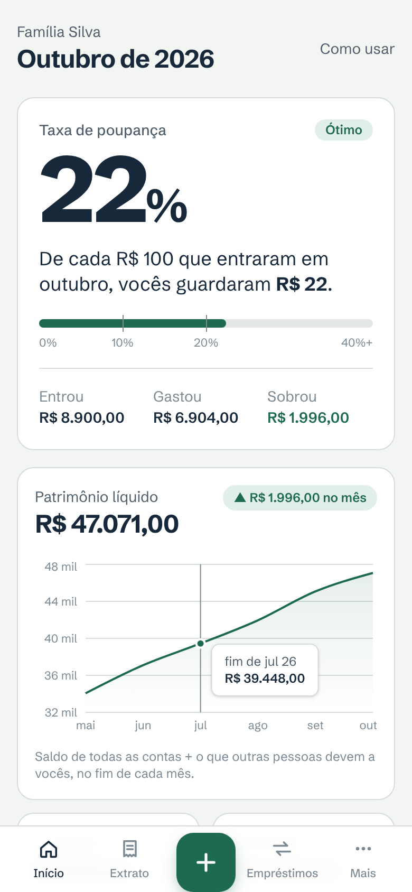
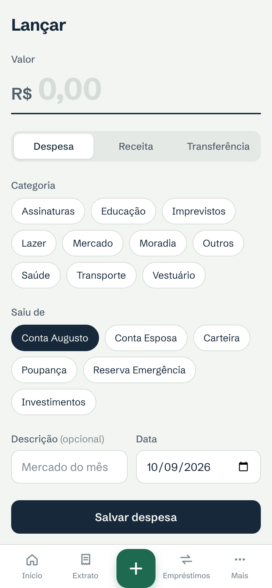
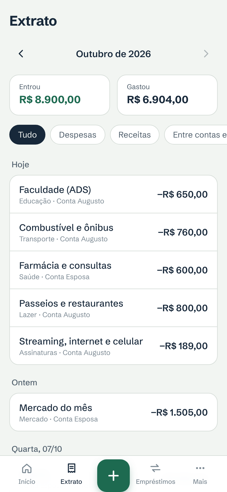
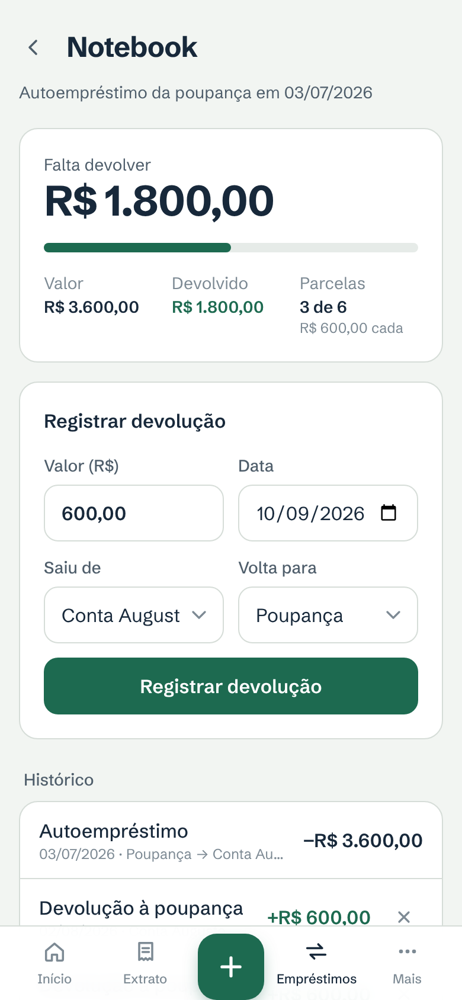
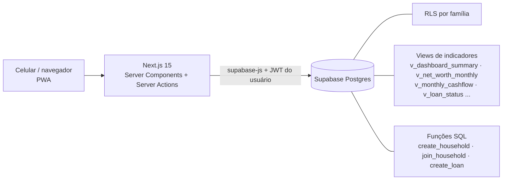

# Caderneta — painel financeiro familiar

> Micro-SaaS para um casal administrar o **patrimônio** da família com o mínimo de lançamentos.
> O número principal não é quanto foi gasto em pão: é **quanto da renda a família guarda por mês**.


<p>
  
  
  
  
</p>

**Demo:** `https://<seu-app>.vercel.app` · **Publicar o seu:** [guia passo a passo](docs/GUIA-PUBLICACAO.md)

## O problema

Planilhas simples geram pouca visão; apps financeiros prontos pedem tanto cadastro que a família
desiste de alimentar. A Caderneta parte da premissa oposta — **poucos lançamentos, indicadores
automáticos** — e responde cinco perguntas:

1. **Quanto da renda estamos guardando?** → taxa de poupança `(receitas − despesas) ÷ receitas`
2. **O patrimônio está crescendo?** → patrimônio líquido no fim de cada mês
3. **Quanto temos a receber?** → empréstimos a parentes e amigos
4. **Quanto devemos à nossa própria poupança?** → autoempréstimos com parcelas
5. **Para onde foi o dinheiro?** → despesas por categoria

## Funcionalidades

- Login por e-mail e senha; **família compartilhada** com convite por código
- **Lançamento rápido** (valor → categoria → conta → salvar) pensado para o celular
- **Saldos calculados**, nunca digitados: saldo inicial + entradas − saídas
- Empréstimos a terceiros e **autoempréstimos** com parcelas, status e histórico
- Painel com taxa de poupança em destaque, evolução do patrimônio (12 meses) e gastos por categoria
- Extrato mensal com filtros, edição e exclusão
- **Exportação CSV** (backup e base para análises)
- PWA instalável, tema claro/escuro, interface em pt-BR

## Arquitetura



Toda a regra de negócio mora no banco. O Next.js lê views prontas e chama funções SQL;
não existe cálculo financeiro no frontend.

| Decisão | Por quê |
|---|---|
| Valores em centavos (`bigint`) | Sem erro de arredondamento de ponto flutuante |
| Saldo = saldo inicial + movimentações | Uma fonte da verdade; nada para "conciliar" |
| `CHECK` por tipo de lançamento + FKs compostas `(household_id, id)` | O banco recusa lançamento inválido ou que aponte para dados de outra família |
| Indicadores como **views SQL** com `security_invoker` | Lógica testável em SQL; views herdam o RLS de quem consulta |
| **Row Level Security** em todas as tabelas | Isolamento entre famílias garantido no banco, não no código |
| Criação de empréstimo via função SQL | Empréstimo + lançamento de saída gravados de forma atômica |
| Server Actions + validação Zod espelhando os `CHECK` | Mensagens claras em português antes de chegar ao banco |

Detalhes do modelo em [`docs/DATA_MODEL.md`](docs/DATA_MODEL.md).

## Stack

Next.js 15 (App Router, TypeScript) · Supabase (Postgres, Auth, RLS) · Tailwind CSS 4 · Recharts ·
Zod · Vitest · Playwright · GitHub Actions · Vercel

## Testes

| Camada | O que cobre | Comando |
|---|---|---|
| **SQL** (34) | Saldos, taxa de poupança, patrimônio, status de empréstimo, lançamentos inválidos bloqueados, isolamento entre famílias (RLS), atomicidade | `npm run test:db` |
| **Unitários** (18) | Conversão de dinheiro pt-BR ↔ centavos, datas no fuso de Brasília | `npm test` |
| **Ponta a ponta** (4) | O casal inteiro: cadastro → família → lançamentos → empréstimos → convite → edição → exclusão | `npm run test:e2e` |

O CI roda lint, testes unitários, build e testes SQL a cada push.

## Rodando localmente

Pré-requisitos: Node.js 20+, Docker e [Supabase CLI](https://supabase.com/docs/guides/cli).

```bash
npm install
supabase init            # aceite os padrões; as migrations já estão em supabase/migrations
supabase start           # sobe Postgres + Auth locais e aplica as migrations
cp .env.example .env.local   # cole a API URL e a anon key mostradas pelo comando acima
npm run dev              # http://localhost:3000
```

Dados fictícios para prints/demo: [`supabase/demo-data.sql`](supabase/demo-data.sql).

## Estrutura

```
src/
  app/(app)/        telas internas: painel, lançar, extrato, empréstimos, mais/*
  app/login, app/comecar, app/exportar
  actions/          Server Actions (validação Zod → Supabase)
  components/       UI própria (Tailwind), formulário de lançamento, gráfico
  lib/              dinheiro, datas, sessão, tradução de erros do Postgres
supabase/
  migrations/       schema versionado
  tests/            testes SQL
  setup-completo.sql  migrations unidas (instalação pelo SQL Editor)
tests/e2e/          Playwright
docs/               PRD, modelo de dados, roadmap, guia de publicação
```

## Roadmap

v0.1 (este) está completo. Próximos: metas com projeção de data, valor de mercado dos investimentos,
importação de extrato e um notebook de análise exploratória sobre o CSV exportado.
Veja [`docs/ROADMAP.md`](docs/ROADMAP.md).

## Autor

**Augusto** — estudante de ADS em transição para Análise/Engenharia de Dados. Florianópolis, SC ·
[LinkedIn](https://linkedin.com/in/<seu-perfil>)

## Licença

MIT
