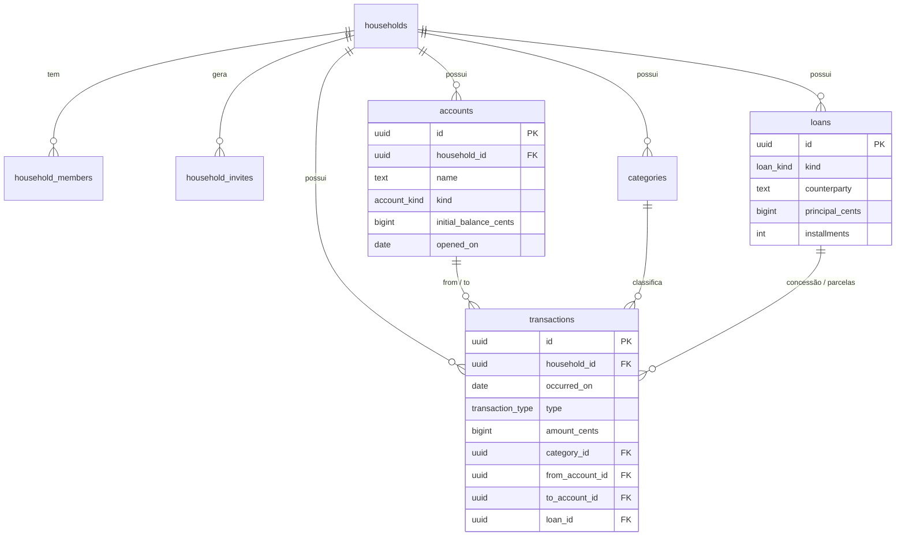

# Modelo de dados

Schema: [`20261008000001_init.sql`](../supabase/migrations/20261008000001_init.sql) (tabelas, regras, RLS, views) e
[`20261009000001_app_support.sql`](../supabase/migrations/20261009000001_app_support.sql) (`create_loan`, lista de membros, fuso horário).

## Diagrama

## Uma tabela de lançamentos, sete tipos

Todo dinheiro que se move é uma linha em `transactions`. O tipo define quais campos são
obrigatórios — e o banco recusa qualquer combinação diferente (`CHECK shape_by_type`).

| Tipo | Sai de | Entra em | Exige | Afeta patrimônio? |
|---|---|---|---|---|
| `income` receita | — | conta | categoria de receita | ↑ sim |
| `expense` despesa | conta | — | categoria de despesa | ↓ sim |
| `transfer` transferência / aplicar / resgatar | conta | conta | — | não |
| `loan_out` empréstimo concedido | conta | — | empréstimo `third_party` | não (vira "a receber") |
| `loan_in` recebimento de empréstimo | — | conta | empréstimo `third_party` | não ("a receber" vira saldo) |
| `self_loan_out` autoempréstimo | poupança | conta | empréstimo `self` | não |
| `self_loan_return` devolução | conta | poupança | empréstimo `self` | não |

Por isso a **taxa de poupança** usa só `income` e `expense`: transferências e empréstimos
movem dinheiro, mas não são ganho nem gasto.

## Indicadores (views)

| View | O que entrega |
|---|---|
| `v_account_balances` | Saldo atual de cada conta |
| `v_loan_status` | Por empréstimo: pago, saldo, parcela, status (`open`/`partial`/`paid`) |
| `v_monthly_cashflow` | Por mês: receitas, despesas, saldo e **taxa de poupança** |
| `v_expenses_by_category` | Despesas por categoria e mês |
| `v_net_worth_monthly` | Patrimônio ao fim de cada mês = contas + a receber |
| `v_dashboard_summary` | Uma linha com tudo do topo do dashboard (mês corrente) |

Patrimônio líquido = soma dos saldos das contas + empréstimos a receber de terceiros.
Autoempréstimo **não** altera o patrimônio (o dinheiro só trocou de conta); ele mede
disciplina: quanto a poupança está "devendo".

## Integridade e segurança

- **FKs compostas** `(household_id, id)`: um lançamento não consegue apontar para conta,
  categoria ou empréstimo de outra família.
- **RLS** em todas as tabelas via `is_member(household_id)`. Views com
  `security_invoker = true` herdam o filtro do usuário logado.
- Famílias e membros só são criados por RPCs (`create_household`, `create_invite`,
  `join_household`), nunca por insert direto.
- `create_loan` é `SECURITY INVOKER`: grava empréstimo + lançamento de saída numa única
  transação, sujeita ao RLS de quem chama. Excluir um empréstimo apaga seus lançamentos (cascade).
- O fuso do banco é `America/Sao_Paulo`, então `current_date` das views segue o horário de Brasília.

## Testes

`supabase/tests/*_test.sql` cobrem 34 cenários: saldos, status de empréstimo,
taxa de poupança, patrimônio, lançamentos inválidos bloqueados, isolamento entre famílias,
atomicidade do `create_loan` e cascade na exclusão.
